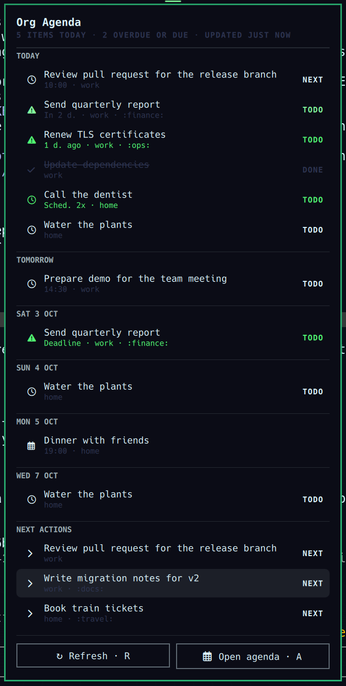

# Org Agenda for Omarchy

An Omarchy bar widget for your [Org mode](https://orgmode.org) agenda. The bar
shows how many open items are on today's agenda and turns to the accent color
when something is overdue or a deadline is due today. Click it for a panel
with today's items, the rest of the week, and your next actions.

The data comes from your running Emacs server, through org-agenda's own entry
collection. The widget therefore sees exactly what `M-x org-agenda` sees: your
`org-agenda-files`, TODO keywords, repeaters, deadline warnings, and overdue
scheduled items. Nothing is parsed outside Emacs.



## Requirements

- Emacs with Org, running as a server (`emacs --daemon`, the `emacs.service`
  systemd user unit, or `M-x server-start` in a regular session).
  `emacsclient` must reach it with its defaults; set `EMACS_SOCKET_NAME` in
  the shell's environment if you use a named server.
- Optional: `inotify-tools`, so the widget refreshes as soon as you save an
  agenda file. Without it, the widget refreshes on a timer.

## Install

```bash
omarchy plugin add https://github.com/landgraf/org-agenda-plugin --enable
```

To try a local checkout instead, copy it (symlinks are not allowed) to
`~/.config/omarchy/plugins/org-agenda/` and run
`omarchy plugin enable org-agenda --section center`.

## Using it

The bar shows the open items on today's agenda.

| Action | Result |
|--------|--------|
| Left-click | Open the panel |
| Middle-click | Refresh now |
| Right-click | Open `org-agenda-list` in a new Emacs frame |

The panel lists:

- **Today**: everything `org-agenda-list` shows for today, including overdue
  scheduled items and upcoming deadlines inside their warning period.
- **Following days**: only days that have something on them.
- **NEXT actions**: open headings with the `NEXT` keyword (configurable).

Overdue items and deadlines due today are shown in the urgent color, and
upcoming deadlines in the accent color. Click a row to open its heading in
Emacs. In the panel, `R` refreshes and `A` (or Enter) opens the full agenda.

## Settings

Set them on the bar entry:

```bash
omarchy bar set org-agenda days 14 --json
omarchy bar set org-agenda nextKeyword TODO
omarchy bar set org-agenda refreshIntervalSec 600 --json
```

| Key | Default | Meaning |
|-----|---------|---------|
| `days` | `7` | Days of agenda to show, starting today (1–31) |
| `nextKeyword` | `NEXT` | TODO keyword listed under next actions; an empty string hides the section |
| `refreshIntervalSec` | `300` | Timed refresh interval, in seconds (minimum 30) |

## How it works

- `collect.sh` asks the Emacs server to load `collect.el` and write an agenda
  snapshot as JSON. It uses `org-agenda-get-day-entries` for each day and
  `org-map-entries` for next actions. The elisp only reads; it opens agenda
  files in buffers the same way `org-agenda` does.
- `watch.sh` asks Emacs for the directories of your agenda files and watches
  them with `inotifywait`, so a save triggers a refresh.
- `BarWidget.qml` and `Panel.qml` render the snapshot.

Changes to `org-agenda-files` show up on the next refresh. Agenda files in a
directory that wasn't watched before trigger instant refreshes only after
`omarchy restart shell`.

## Troubleshooting

- **The bar shows `!`**: hover it, or open the panel, to see the error. Most
  often the Emacs server is not running.
- **Items are missing**: compare with `M-x org-agenda a`. If Emacs doesn't
  show them either, check `org-agenda-files`.
- **Force a refresh**: `omarchy-shell org-agenda refresh`.

## License

MIT
